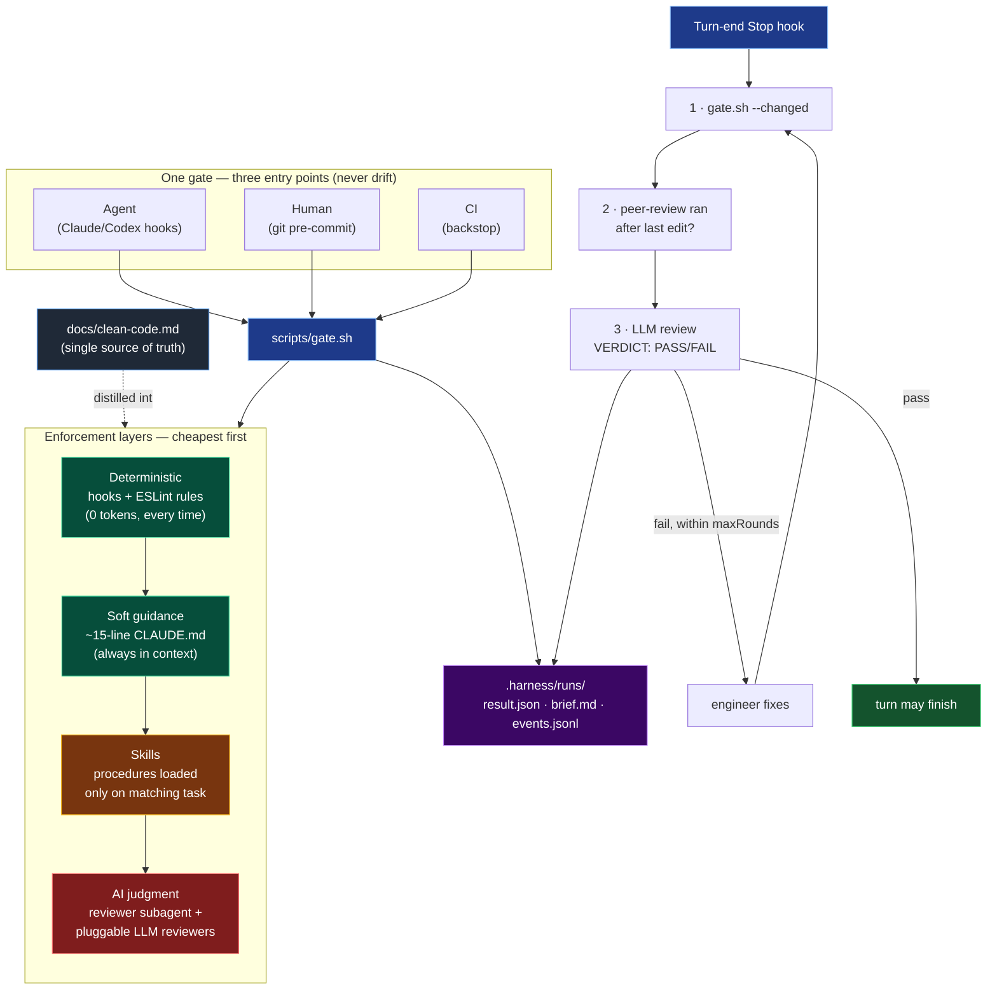

# Quality Enforcement Harness

Layered, token-efficient quality gates for React/TypeScript projects worked on by
AI coding agents (Claude Code, Codex, …) **and** humans. One rulebook, enforced at
the cheapest layer that can catch each violation.

> A portfolio piece: a working, self-contained example of how to make a coding
> standard *actually stick* across agents and people — without burning the agent's
> context window or slowing humans down.

---

## Why this exists

Coding standards usually fail in one of two ways:

1. **They live in a doc nobody reads.** A 40-page style guide has zero enforcement
   power. Humans skim it once; an AI agent never sees it at the moment it matters.
2. **They get stuffed into the agent's prompt.** Paste the whole standard into
   `CLAUDE.md` and every single turn now pays for thousands of tokens of rules —
   most irrelevant to the task at hand — crowding out the actual work.

This harness resolves that tension with one idea:

> **Enforce every rule at the cheapest layer that can catch it.**

A rule a linter can check should never cost a token. A rule that needs judgment
should reach an AI reviewer — but only once per turn, and only on the diff. The
result is a standard that is *always on*, *cheap*, and *impossible to quietly
skip* — the same `gate.sh` runs whether the code came from an agent, a git
pre-commit hook, or CI.

### Design principles

| Principle | What it buys |
|---|---|
| **Cheapest layer wins** | Deterministic rules cost zero tokens; expensive AI review is reserved for genuine judgment calls. |
| **One source of truth** | Every rule traces to `docs/clean-code.md`; nothing is duplicated, so nothing drifts. |
| **One gate, three entry points** | Agent hooks, git pre-commit, and CI all call the *same* script — they can never disagree. |
| **Advisory before blocking** | New checks start as `report`, get promoted to `block` only after they've proven themselves. |
| **Auditable escape hatches** | Every override (`// hoisted:`, `SKIP_TESTS_CHECK=1`, baselines) is explicit and greppable. |
| **Observability by default** | Every run and every tool call is logged to `.harness/runs/` for a TUI or dashboard to read. |

---

## How it works

Each layer catches what the layer below it can't — from free deterministic checks
up to AI judgment — and they all read from one rulebook.

```
Deterministic rules  → hooks + ESLint          (fire every time, zero tokens)
Soft design guidance → lean CLAUDE.md (~15 lines, always on)
Procedures/reference → skills                   (loaded only when the task matches)
Judgment calls       → read-only reviewer subagent + pluggable AI reviewers
Turn-end enforcement → Stop hook: gate → peer-review proof → LLM review (capped rounds)
Observability        → .harness/runs/: per-run artifact bundles + JSONL activity feed
One source of truth  → docs/clean-code.md       (imported everywhere, duplicated nowhere)
```

### The flow



**Reading the diagram:** everything descends from one rulebook. Work enters the
gate from three places (agent, human, CI) but hits the *same* checks. When an
agent tries to end its turn with uncommitted work, the Stop hook runs three
escalating checks — deterministic gate, proof that peer review happened, then an
LLM verdict — looping the engineer through fixes a bounded number of times. Every
run drops artifacts into `.harness/runs/` so a UI can observe without ever being
in the enforcement path.

---

## See it run (TUI)

The harness core is UI-agnostic: enforcement lives entirely in bash + ESLint, and
`.harness/runs/` is a plain artifact store that any surface can read. A terminal
UI over that store gives a live view of gate runs, reviewer findings, and agent
activity — **without ever being an enforcement path**.

<!--
  TODO: add the TUI walkthrough video here.
  On GitHub, drag-and-drop an .mp4/.mov/.webm into the README editor (or a PR/issue
  comment) — GitHub uploads it and inserts a user-attachment URL you can paste below.
  Keep the clip short (30–60s): a gate run blocking, a fix, and a clean pass.
-->

> 🎥 **Video coming soon** — a short walkthrough of the TUI reading the live
> `.harness/runs/` feed will be embedded here.

---

## Install

From the target project root (recommended):

```bash
cd /path/to/project
bash /path/to/harness/install.sh
```

Or via npx — no argument needed, it installs into the directory you run it from:

```bash
npx --yes -p /path/to/harness quality-harness                  # local checkout
npx --yes github:<your-username>/quality-enforcement-harness   # once pushed to GitHub
```

Merges into existing config (CLAUDE.md, .claude/settings.json,
harness.config.json, eslint) — never clobbers, backs up what it touches,
asks before installing anything.

## Upgrade

Re-running the installer IS the upgrade path — it is idempotent:

- `scripts/` and `.claude/hooks/` are overwritten with the current versions.
- `.claude/settings.json`: harness-owned hook entries (any entry referencing a
  script in `hooks/`) are **replaced**, never duplicated; your own hooks and
  permissions are untouched.
- `harness.config.json`: **new keys are added, your tuned values always win**
  (recursive; reviewers matched by name). The installer prints what it added.

Then start a new Claude Code session — hook registrations are snapshotted at
session start, so an open session keeps the old wiring until restarted.

## One gate, three entry points

`scripts/gate.sh` is the single gate. It runs from Claude hooks (pre-commit +
Stop), lefthook git pre-commit (humans/other agents), and CI (backstop). The
three can never drift because they are the same script. It reads config once,
caches ESLint runs, and covers committed + staged + unstaged work in
`--changed` mode.

## The Stop hook: three checks before the agent may finish

When a turn ends with uncommitted work, `hooks/stop-gate.sh` runs, in order:

1. **gate.sh** `--changed` — the deterministic checks.
2. **subagent-review-check.sh** — proof (from the activity log) that the
   `code-reviewer` subagent ran *after* the last edit; blocks with
   instructions if not (`harness.config.json → subagentReview`).
3. **llm-review.sh** — each enabled CLI reviewer (e.g. codex) reviews the
   diff against clean-code.md; a report ending `VERDICT: FAIL` blocks when
   `llmReview.mode` is `"block"`.

Fix rounds are capped per session by `llmReview.maxRounds` (default 2) so two
models can never argue forever. Reviewer reports are saved under
`.harness/runs/` either way.

## Observability (`.harness/runs/`)

- Every gate run writes an artifact bundle: `result.json`, `brief.md`, and
  per-check output under `checks/`.
- Every tool call is appended to `runs/<date>/events.jsonl` by an async
  PostToolUse hook (never blocks, `logging.enabled: false` turns it all off).
- Retention: `logging.retainDays` (default 30).

## Rule → layer → file map (change a rule here)

Accepted standards live in `docs/clean-code.md`. Rows marked **planned** describe
the target enforcement adapter; they do not claim that adapter is deployed.
Contextual observations never block by themselves.

| Rule | Enforced by | Change in |
|---|---|---|
| All standards (source of truth) | everything below | `docs/clean-code.md` |
| Feature boundaries (shared ← features ← app) | eslint-plugin-boundaries | `eslint/boundaries.config.mjs`, paths in `harness.config.json → boundaries` |
| Courier hooks (state colocation) | ESLint `local/no-courier-hooks` + reviewer | `eslint/rules/no-courier-hooks.mjs` |
| Direct dependency ownership and cached-hook safety | ESLint `local/dependency-ownership-signal` facts + observation/reviewer (**planned**) | `docs/clean-code.md §2`, observation policy |
| No custom Context Provider for local feature state | JSX/import facts + observation/reviewer (**planned**) | `docs/clean-code.md §2`, observation policy |
| No setters/dispatch as props | ESLint `no-restricted-syntax` + `Dispatch<>` grep in gate | `eslint/base.config.mjs`, `scripts/gate.sh` |
| Banned/structural/numeric names | ESLint `id-denylist` + `no-restricted-syntax` | `eslint/base.config.mjs` |
| onX props / handleX handlers | `react/jsx-handler-names` (installer adds) | eslint config |
| Hook composition (>3 non-exempt coordinating hooks) | ESLint `local/hook-composition-signal` facts + observation engine; never raw-count blocking (**planned**) | `docs/clean-code.md §6`, observation policy |
| Independent sibling regions | ESLint `local/component-boundary-signal` facts + observation engine; never child-count blocking (**planned**) | `docs/clean-code.md §5`, observation policy |
| Stable module-scope component definitions | React Compiler/static-components ESLint (**planned**) | `docs/clean-code.md §5`, eslint config |
| Inline `.map()` in JSX | `local/no-inline-jsx-map` | `eslint/rules/no-inline-jsx-map.mjs` |
| SUT imported last (tests) | `local/sut-import-last` | `eslint/rules/sut-import-last.mjs` |
| "should" test names, no test conditionals | eslint-plugin-jest / -playwright | eslint config |
| Filename conventions | PreToolUse hook + gate | `scripts/check-filename.sh` |
| Protected dirs (Open-Closed) | PreToolUse hook | `harness.config.json → protectedDirs` |
| Complexity/size proxies | ESLint metrics (+sonarjs) | `eslint/base.config.mjs` |
| Duplication (rule of three) | fallow baseline (jscpd fallback) | gate + `npx fallow dupes --save-baseline` |
| Repeated JSX layouts | shape detector (report-only) | `scripts/jsx-shape-dupes.mjs` |
| Dead code | knip (report-only) | gate |
| Secrets / SAST | gitleaks (block) / semgrep (report) | gate |
| Quality ratchet (lint warnings, type coverage) | `scripts/ratchet.mjs` | `.quality-baseline.json` |
| Tests accompany code | gate (`SKIP_TESTS_CHECK=1` escape hatch) | `scripts/gate.sh` |
| TDD red-green, vertical slices | TDD Guard (optional) + tdd skill | `harness.config.json → tddGuard` |
| Conventional commits | commitlint via lefthook | `commitlint.config.mjs` |
| E2E conventions, tracer bullets | e2e skill + eslint-plugin-playwright | `templates/skills/e2e/` |
| Figma/screenshot QA | visual-qa skill + Playwright baselines | `templates/skills/visual-qa/` |
| Visual regression | `toHaveScreenshot()` baselines in gate/CI | committed snapshots |
| SRP/OCP, abstraction, naming judgment | code-reviewer subagent (sonnet) | `templates/agents/code-reviewer.md` |
| Shortest→longest ordering | reviewer only — NEVER mechanical | `docs/clean-code.md §11` |
| Multi-model review (codex, +others) | `scripts/review.sh` | `harness.config.json → reviewers` |
| Peer review ran after last edit | Stop hook + `scripts/subagent-review-check.sh` | `harness.config.json → subagentReview` |
| Turn-end LLM review (VERDICT gate) | Stop hook + `scripts/llm-review.sh` | `harness.config.json → llmReview`, `reviewers` |
| Run artifacts + tool-activity log | gate + async PostToolUse hook | `harness.config.json → logging` |
| Model/cost routing | config per task | `harness.config.json → models` |
| Tautological tests | reviewer + Stryker (weekly CI) | `stryker.config.json` |
| Observation routing and one-repair limit | harness observation schema/policy (**planned**) | `docs/clean-code.md §12` |

### Known migration conflict

`eslint/base.config.mjs` currently configures
`local/max-usestate-per-component` as an error. That legacy raw-count blocker
conflicts with the accepted contextual hook-composition policy. Replace it with
the non-blocking `local/hook-composition-signal` fact rule when implementing the
observation adapter; do not deploy the legacy rule as new-policy enforcement.

## Severity model

Every gate check has a severity in `harness.config.json → checks`:
`block` · `block-new` (baseline-relative) · `report` (advisory) · `off`.
New checks start as `report`; promote after a week of observation.
External AI reviewers are advisory by default — only deterministic checks block.
The turn-end LLM review is the exception when `llmReview.mode` is `"block"`:
its findings feed back to the engineer for at most `maxRounds` fix cycles,
then it yields with the report saved to `.harness/runs/`.
An observation stays non-blocking; promotion requires replacing it with a
separately specified, deterministic rule.

## Escape hatches (all auditable)

- `// hoisted: <reason>` — legitimate state lift
- `SKIP_TESTS_CHECK=1` — no-behavior changes (renames, comments)
- `npx fallow dupes --save-baseline` — accept justified duplication
- `node scripts/ratchet.mjs update` — lock in improvements

## Testing the harness itself

```bash
npm install eslint @babel/parser   # if not already present
node eslint/rules/__tests__/no-courier-hooks.test.mjs
node eslint/rules/__tests__/max-usestate-per-component.test.mjs
node eslint/rules/__tests__/sut-import-last.test.mjs
node eslint/rules/__tests__/no-inline-jsx-map.test.mjs
node scripts/__tests__/jsx-shape-dupes.test.mjs
bash scripts/__tests__/run-logging.test.sh          # gate artifact bundles + activity log
bash scripts/__tests__/nested-config-gate.test.sh   # config walk-up + fail-closed
bash scripts/__tests__/llm-review.test.sh           # verdict gating, advisory mode
bash scripts/__tests__/check-filename.test.sh       # rename suggestions (BSD/GNU portable)
```

## Repo layout

```
harness/
├── docs/clean-code.md      # single source of truth for every rule
├── docs/getting-started.html
├── docs/visuals/           # interactive enforcement map
├── scripts/gate.sh         # the one gate (agent + git + CI all call this)
├── scripts/                # reviewers, ratchet, logging, detectors (+ __tests__)
├── hooks/                  # Claude Code PreToolUse / PostToolUse / Stop hooks
├── eslint/rules/           # custom lint rules (+ __tests__)
├── standards/              # rule set, split by area, compiled into clean-code.md
├── templates/              # skills + reviewer agent shipped into target repos
├── ci/                     # reusable CI workflows
├── harness.config.json     # one place to tune enforcement, reviewers, models
└── install.sh              # idempotent installer / upgrader
```
