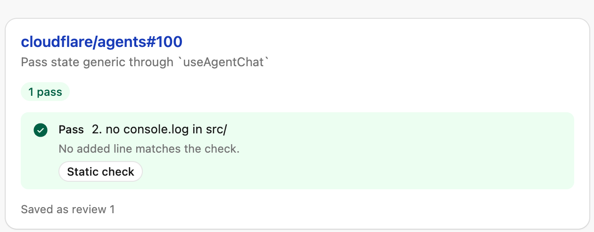
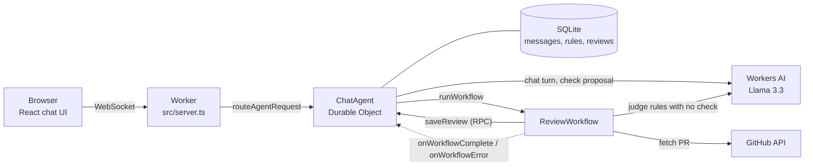
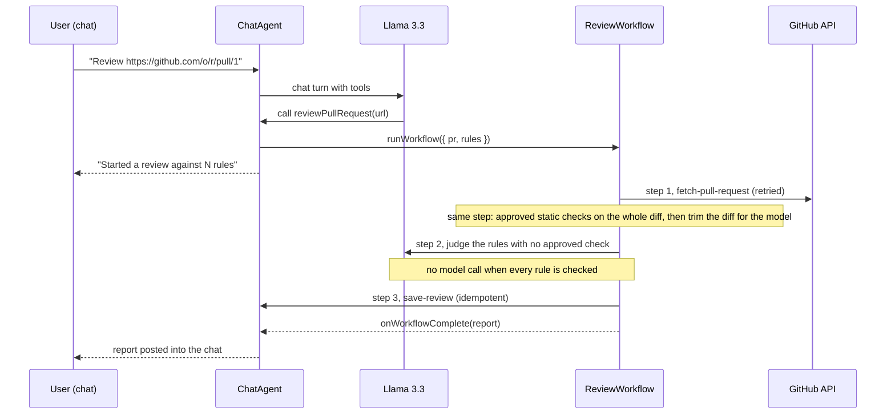
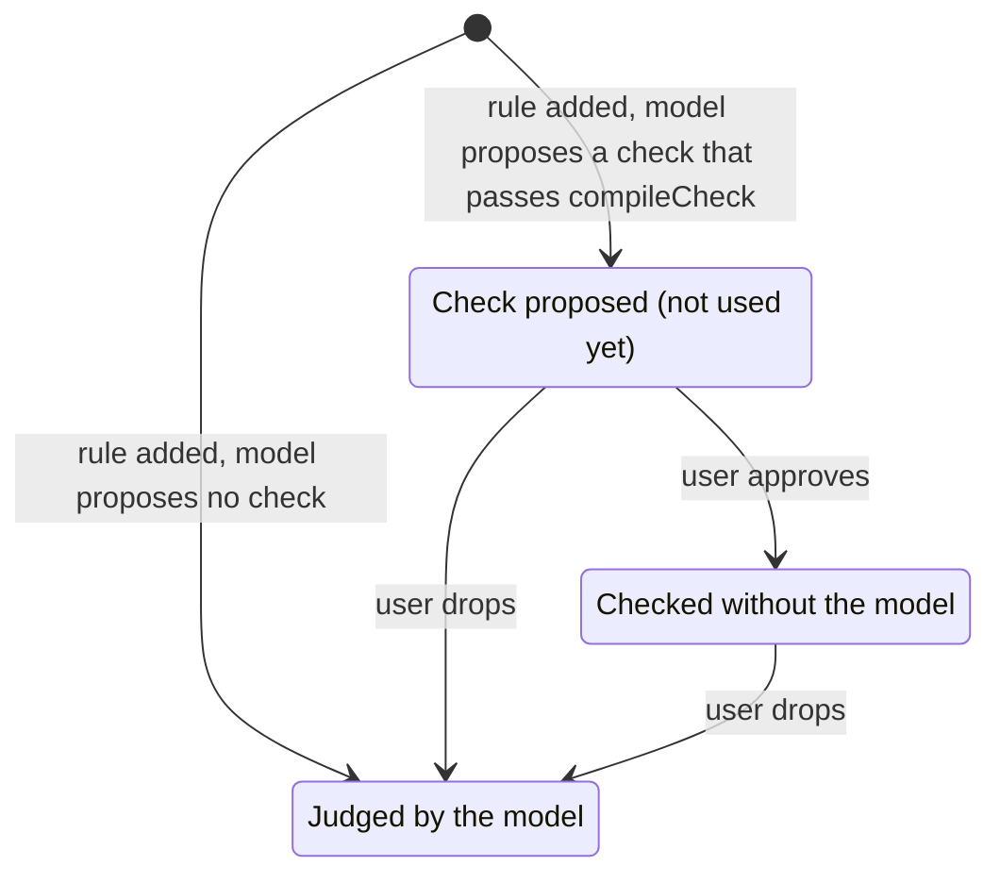
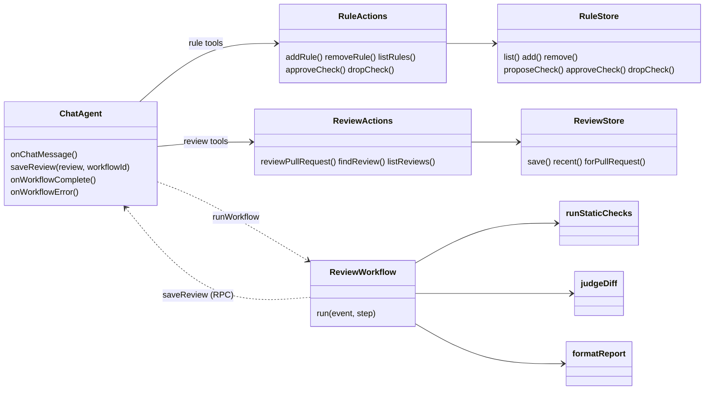

# PR Policy Reviewer

A chat agent on Cloudflare that checks GitHub pull requests against your team's own engineering rules.

You write rules in plain words, such as "no console.log in src/". You paste a pull request link. The agent replies with one line per rule: **pass**, **fail** or **unclear**, with a short reason and, where there is one, the file and line. Rules and past reviews stay in the agent's memory, so you can ask "what did you find on owner/repo#123?" later.

The finished review shows as a card: a link to the pull request, a count of each verdict, and one row per rule with a green tick, a red cross or an amber warning.



A short recording of a review is in [docs/media/pr-policy-reviewer-review-card.gif](docs/media/pr-policy-reviewer-review-card.gif), and one of the Approve step is in [docs/media/pr-policy-reviewer-approval-gate.gif](docs/media/pr-policy-reviewer-approval-gate.gif).

## Why it exists

Teams have rules that code review should enforce. People forget them, and generic linters do not know them. An LLM can read plain-language rules, but it is slow, it can be wrong, and text in a pull request can try to trick it.

So I use **exact code where a rule allows it, and the model only where a rule needs judgement**:

- "No console.log in src/" is a line pattern. A regular expression checks it on every added line, outside generated files and lockfiles. A match gives a `file:line`, and no prompt can change it.
- "Every API route has a test" needs judgement. Llama 3.3 judges it.

When you add a rule, the model proposes a pattern for it. The pattern isn't used until you approve it in the chat. Approving or dropping a check, removing a rule and starting a review each show Approve and Deny buttons, and run only after you click Approve. After a tool runs, the agent replies in words and waits for you, so ask for one thing per message. Each finding in the report is tagged `checked` or `judged by the model`, so you know how much to trust it.

I've written up the design decisions and the checks the app makes in [TECHNICAL_CONSIDERATIONS.md](TECHNICAL_CONSIDERATIONS.md).

## How it maps to the assignment

| Part                      | What this project uses                                                                                                 |
| ------------------------- | ---------------------------------------------------------------------------------------------------------------------- |
| LLM                       | Llama 3.3 70B (`@cf/meta/llama-3.3-70b-instruct-fp8-fast`) on Workers AI, through `workers-ai-provider` and the AI SDK |
| Workflow and coordination | A Cloudflare Workflow (`ReviewWorkflow`) started by the agent. Each step retries on its own, and its result is stored  |
| User input                | Chat, over a WebSocket to the agent (React UI on Workers static assets)                                                |
| Memory and state          | The agent's Durable Object SQLite: the chat history, the rules table and the reviews table                             |

## Architecture



### How a review runs



The agent does not wait for the review, so the chat stays free while it runs. If a step fails, only that step runs again.

### A rule's static check



### Main modules



## Where to start reading

| File                                                                                                                                                  | What it does                                                                                                   |
| ----------------------------------------------------------------------------------------------------------------------------------------------------- | -------------------------------------------------------------------------------------------------------------- |
| [src/server.ts](src/server.ts)                                                                                                                        | The Worker entry point. It routes `/agents/*` to the agent and exports the Durable Object and Workflow classes |
| [src/agent/ChatAgent.ts](src/agent/ChatAgent.ts)                                                                                                      | The agent. It joins the rules and reviews features, starts workflows and posts their results                   |
| [src/features/reviews/workflow/ReviewWorkflow.ts](src/features/reviews/workflow/ReviewWorkflow.ts)                                                    | The three durable review steps                                                                                 |
| [src/features/reviews/services/static-check/runStaticChecks.ts](src/features/reviews/services/static-check/runStaticChecks.ts)                        | The checks that run with no model                                                                              |
| [src/client.tsx](src/client.tsx) → [src/features/chat/components/chat-screen/ChatScreen.tsx](src/features/chat/components/chat-screen/ChatScreen.tsx) | The browser entry point and the chat screen                                                                    |
| [docs/spec.md](docs/spec.md)                                                                                                                          | The behaviour as Given/When/Then scenarios                                                                     |

## Run it locally

You need Node 22.18 or later (or 24.11 or later) and a Cloudflare account. Workers AI has no local simulator, so `wrangler.jsonc` sets `"ai": { "remote": true }`, and the dev server calls Workers AI on your account.

The app lives in the `ai-tools/cf-ai-pr-policy-reviewer` folder of [rfrepo/code](https://github.com/rfrepo/code).

```bash
git clone https://github.com/rfrepo/code.git
```

```bash
cd code/ai-tools/cf-ai-pr-policy-reviewer
```

```bash
npm ci
```

```bash
npx wrangler login
```

If you'd rather not log in, copy `.env.example` to `.env` and add an API token with the "Workers AI: Read" permission. The Vite plugin loads `CLOUDFLARE_*` values from `.env`, and `.gitignore` keeps that file out of git.

```bash
npm run dev
```

Open http://localhost:5173 and try:

- "Add a rule: no console.log in src/"
- "Approve the check for rule 1"
- "Add a rule: every API route has a test"
- "Review https://github.com/cloudflare/agents/pull/100"
- "Show my recent reviews"

Only public repositories work. GitHub allows 60 unauthenticated API requests an hour per IP address.

## Deploy

```bash
npm run deploy
```

## Checks

```bash
npm run check
```

This runs oxfmt, oxlint, `tsc` and Vitest. Vitest has two projects:

- `node`: the services. The store tests use a real in-memory SQLite (`node:sqlite`) behind the same tagged-template shape as the agent's `this.sql`.
- `dom`: the buttons (Send, Stop, Clear, the example prompts, the theme toggle, Retry, Dismiss and Reload), with Testing Library in happy-dom.

Architecture, dead code, duplication and complexity are checked with [fallow](https://docs.fallow.tools), installed globally:

```bash
fallow architecture
```

```bash
fallow dead-code
```

```bash
fallow health
```

## Layout

I group code by feature. The agent is the one place that joins the rules and reviews features.

```
src/
  server.ts, client.tsx, app.tsx   entry points only
  agent/                           ChatAgent: rules + reviews tools, starts workflows, posts results
  features/                        features never import each other
    rules/                         rule checks, check proposals, rule store, chat tools for rules
    reviews/                       URL parsing, GitHub client, diff prep, static checks, prompts,
                                   judge, report, review store, chat tools, ReviewWorkflow
    chat/                          ChatScreen, chat UI components, chat hooks, part mapping,
                                   ReviewCard
  shared/                          code used by two or more features, such as the review card
                                   data that reviews writes and chat draws
```

- Imports only go down: `app → agent → features → shared`. A layer can skip the one below it, so `server.ts` exports `ReviewWorkflow` straight from its feature. The fallow boundaries in `.fallowrc.json` enforce this.
- Each SDK is wrapped once: Workers AI in `shared/services/workers-ai/llama.ts`, GitHub in `features/reviews/services/github/githubClient.ts`, and the agent connection in `features/chat/hooks/use-chat-session/useChatSession.ts`.
- Tests live in `__tests__/` next to the code they cover.

## Design in short

The full reasons are in [TECHNICAL_CONSIDERATIONS.md](TECHNICAL_CONSIDERATIONS.md).

- **Static checks first.** Approved checks run on every added line before the diff is cut for the model, and they skip generated files and lockfiles. The model judges only the other rules.
- **Fail closed.** A rule the model does not answer is "unclear", never "pass".
- **Untrusted text is data.** The diff and the rules go to the model inside tags, with our tags removed from the text.
- **Retry what can succeed.** A GitHub 404, 403, too-large diff or rate limit stops at once. A timeout retries with backoff.
- **Idempotent save.** One workflow gives one saved review, even if the save step runs twice.
- **Fit the model.** At most 24,000 characters of diff with long lines shortened, 2,048 output tokens for the judge, and the 20 most recent messages per chat turn.
- **One agent instance per browser.** Visitors do not see each other's rules or reviews.
- **Every failure is visible.** A failed chat turn shows Retry and Dismiss. A render crash shows Reload, not a blank page. A used-up GitHub rate limit says when to try again.

## Limitations and next steps

- **Rules come from chat in this demo.** In production, they would come from a reviewed file such as `.github/pr-policy.yml`, which is changed only by a pull request that CODEOWNERS approve. The chat input is still guarded: at most 25 rules of at most 300 characters, no duplicates, rule text fenced as data in the review prompts, and every check validated and approved before use. Rules that make no sense ("be nice") are accepted, and the model will usually mark them "unclear".
- **Check approval is a chat instruction.** The system prompt tells the model to call `approveCheck` only when you ask. That isn't an enforced gate. With rules in a reviewed file, the approval would be the pull request review.
- **No login.** A session name is not authentication. A real deployment would put [Cloudflare Access](https://developers.cloudflare.com/cloudflare-one/policies/access/) in front and use the user id as the instance name.
- **GitHub rate limit.** `githubClient.ts` doesn't send a token yet. Adding a `GITHUB_TOKEN` secret (`wrangler secret put`) and sending it from the client would raise the limit and allow private repositories.
- **No Workers-runtime tests.** `ReviewWorkflow` is tested as one pipeline in Node with the Workers modules mocked. `@cloudflare/vitest-pool-workers` 0.23 needs Vitest 4, and this repo uses Vitest 5, so nothing runs in the Workers runtime yet.
- **Checks in CI.** The static checks are plain functions with no Cloudflare dependency. The next step is a GitHub Action that runs the same approved checks on each pull request.
- **Prompt injection.** Tags lower the risk, but they do not remove it. I'd still read any "pass" on a rule that matters.

## Credits

- Started from [cloudflare/agents-starter](https://github.com/cloudflare/agents-starter). The weather, scheduling, MCP and image features were removed.
- `extractJsonObject` and the reshape-only repair prompt are adapted from my own agent-harness project.

## Security notes

Checked on 18 November 2026:

- All packages have verified npm registry signatures (`npm audit signatures`).
- `npm audit` reports high-severity issues in `picomatch` (ReDoS) through Vite and the Agents SDK's Babel plugin. These are build-time tools. No fixed `picomatch` release exists yet, and `picomatch` is not in the built `dist/` output.
- `allowScripts` in `package.json` lists the only packages that may run install scripts (esbuild, workerd, sharp, fsevents). `core-js-pure` (from the Agents SDK, through `mimetext`) is not allowed: its script only prints a message.

## Prompts

The runtime prompts are in [PROMPTS.md](PROMPTS.md).
